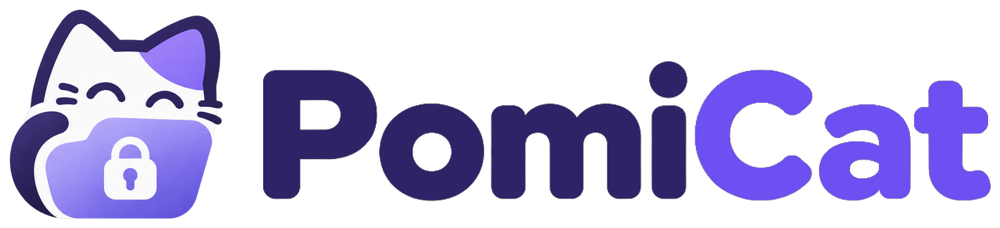
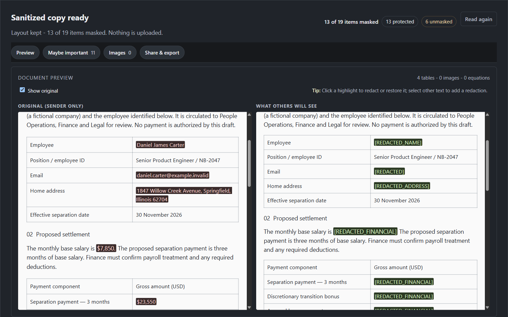

<p align="center">
  <picture>
    <source media="(prefers-color-scheme: dark)" srcset="docs/brand/pomicat-logo-dark.png">
    
  </picture>
</p>

<p align="center">
  <a href="https://github.com/darflashxd/pomicat/actions/workflows/test.yml"></a>
  <a href="LICENSE"></a>
  <a href="https://github.com/darflashxd/pomicat/releases"></a>
</p>

<h3 align="center">Share the content. Not the secrets.</h3>

<p align="center">
  A browser extension that reviews an AI chat or a document before you share it, hides private
  details and the numbers that would give them away, and sends an encrypted copy.
</p>

- **On your device:** rules and a small model run in the browser. Nothing leaves while you review.
- **Beyond the obvious:** hides the salary, and also the "saving 20% is $1,000" line that reveals it.
- **Encrypted links:** the key lives after the `#`. The relay stores ciphertext; crawlers get nothing readable.
- **Chats and documents:** ChatGPT, Claude, Gemini, DeepSeek, Word Online and Google Docs.

[Quick start](#quick-start) · [Docs](https://darflashxd.github.io/pomicat/) ·
[Blog](https://darflashxd.github.io/pomicat/blog/) · [Releases](https://github.com/darflashxd/pomicat/releases) ·
[Security](SECURITY.md) · [Contributing](CONTRIBUTING.md)

| AI conversations | Word documents |
|---|---|
|  |  |

*Fictional data in both captures.*

> [!WARNING]
> Detection can miss things. Read the copy before you share it. An empty attack check means the
> supported checks found nothing, not that the copy is anonymous. Anyone holding the complete link
> can read the copy and save it; expiry and revocation cannot recall saved copies.

## Highlights

<table>
<tr>
<td width="33%" valign="top"><b>Side-by-side review</b><br>The original and what others will see, next to each other. Click a highlight to hide or restore it, or select any text to hide it yourself.</td>
<td width="33%" valign="top"><b>Arithmetic checks</b><br>Finds ratios, monthly and yearly versions, projections, sums and differences of a hidden amount across the whole chat, and runs the attack before you share.</td>
<td width="33%" valign="top"><b>Encrypted sharing</b><br>AES-256-GCM in the browser. Links expire, can burn after one read, and can be revoked. Opening needs a click, so link scanners do not use them up.</td>
</tr>
<tr>
<td valign="top"><b>Word Online and Google Docs</b><br>Reviews a separate DOCX copy of the document. Removes tracked changes, comments and document properties, and replaces image pixels you mark.</td>
<td valign="top"><b>Protect before sending</b><br>Optional. Sends amounts as <code>&lt;S1&gt;</code> and IDs as placeholders, then computes the reply's formulas on your screen.</td>
<td valign="top"><b>CLI and proxy</b><br>Redact transcripts, run the attack offline, or put a redacting proxy in front of OpenAI and Anthropic APIs.</td>
</tr>
</table>

## Why hiding the number is not enough

```text
User:      My salary is [REDACTED] a month. If I save 20%, how much is that?
Assistant: Saving 20% means $1,000 per month, leaving $4,000 for expenses.

$1,000 / 0.20 = $5,000
```

PomiCat hides the derived figures too, then checks the copy with the same attack.

| Check | Without PomiCat | With PomiCat |
|---|---|---|
| An LLM recovers a hidden salary (3 models, 4 runs of 40 fictional chats, EN + ID) | 100% after naive redaction and after Presidio | 0 of 160 |
| Rule-based arithmetic attacker, 40 chats | 53% naive, 100% Presidio | 0% |
| Birth date narrowed to 4 days or fewer from weekday clues | 40 of 40 | 0 of 40 |
| A crawler fetching a share link (chat or document) | A plain share page shows the full text | Ciphertext only, no key, `noindex` |

The chats are templated and fictional. Details and limits: [LLM attacker](tools/attack_bench/RESULTS_LLM.md),
[arithmetic attacker](tools/attack_bench/RESULTS.md), [evaluation report](tools/eval/RESULTS.md),
crawler check in [`tests/relay_lifecycle.test.js`](tests/relay_lifecycle.test.js).

## How it works

```text
Read the conversation or document
        ↓
Rules, context checks and a local model mark private details
        ↓
Arithmetic checks find numbers that reveal a hidden value
        ↓
You review, hide or restore
        ↓
AES-256-GCM encryption in the browser
        ↓
Ciphertext to the relay · key stays after the # · viewer decrypts
```

| Part | Code |
|---|---|
| Patterns, IDs and credentials | [heuristics.js](extension/engine/heuristics.js) |
| Personal context and topics | [contextual.js](extension/engine/contextual.js) |
| Derived numbers across turns | [pseudonymizer.js](extension/engine/pseudonymizer.js) |
| Local model (BERT-small INT8) | [offscreen.js](extension/offscreen.js) |
| Review and sharing | [modal.js](extension/ui/modal.js) |
| Encryption | [crypto.js](extension/engine/crypto.js) |
| Relay (Cloudflare Worker + D1) | [worker.js](relay/worker.js) |

## Quick start

### Install

**Chrome, Edge and Brave:** download the Chrome ZIP from
[Releases](https://github.com/darflashxd/pomicat/releases/latest) and extract it. Open
`chrome://extensions`, turn on **Developer mode**, choose **Load unpacked** and select the folder.
Refresh any chat or Word tabs that were already open.

**Firefox:** download the Firefox ZIP, open `about:debugging#/runtime/this-firefox`, choose
**Load Temporary Add-on** and pick its `manifest.json`. Temporary add-ons are removed on restart.

The model and runtime are bundled: no Python, model download or API key needed.

### Make your first share

1. Open a short fictional chat on ChatGPT, Claude, Gemini or DeepSeek and click the PomiCat button.
2. Check every message was read, then compare the original with the copy others will see.
3. Hide or restore highlights, select anything the detectors missed, and **Create Private Link**.
4. Open the link in a private window and check what the recipient sees.
5. Revoke it from the extension's toolbar page and confirm it no longer opens.

For documents, open a saved `.docx` in Word Online or a Google Doc and click the PomiCat button.
See the [document guide](https://darflashxd.github.io/pomicat/#word).

### Try the attack offline

Node.js 18 or newer. No account, key, model or relay.

```bash
git clone https://github.com/darflashxd/pomicat.git
cd pomicat
node bin/safeshare.js invert examples/chat_naive_redacted_en.txt
node bin/safeshare.js redact examples/chat_original_en.txt | node bin/safeshare.js invert
```

The first command recovers `$5,000`. The second prints `No hidden values recovered.`

## Requirements

| Need | Details |
|---|---|
| Browser | Chrome, Edge or Brave (Manifest V3), or Firefox 109+ |
| Sites | ChatGPT, Claude, Gemini, DeepSeek, Word Online (SharePoint, depends on the tenant), Google Docs |
| CLI | Node.js 18+, no dependencies |
| Building packages | Python 3 (`python tools/build_extension.py`) |
| Your own relay | Python 3 for the local relay, or Cloudflare Workers + D1 ([DEPLOY.md](DEPLOY.md)) |

## Limits

- **English-focused model.** Other languages rely mostly on rules. Indonesian formats (NIK,
  Rupiah, local banks and addresses) are covered by rules and tests.
- **Not every inference.** Supported arithmetic, birth years and weekday dates are checked.
  Combinations of details (job, town, age) can still point to a person.
- **Not image text.** Mark it by hand. Attachments and every field of pasted logs are not covered.
- **The chat site sees what you type.** Before-sending protection changes what is submitted, not
  what the page can read.
- **Links are bearer links.** The relay sees IP addresses, timing and sizes. Without the
  extension, the hosted viewer must be trusted. Screenshots cannot be prevented.
- If a real password was already sent to a service, change it.

The full [security model](https://darflashxd.github.io/pomicat/#security) lists each risk and what remains.

## Documentation

| Read | For |
|---|---|
| [Docs site](https://darflashxd.github.io/pomicat/) | Install, chat and Word guides, security model, troubleshooting, FAQ |
| [DEPLOY.md](DEPLOY.md) | Running your own relay, locally or on Cloudflare |

## Contributing

See [CONTRIBUTING.md](CONTRIBUTING.md). Report security problems privately as described in
[SECURITY.md](SECURITY.md).

## Responsible use

PomiCat helps you decide what to share. It does not make a copy anonymous on its own, and the
attack tools in this repository are for synthetic data or data you are allowed to examine.

## License

Apache-2.0, see [LICENSE](LICENSE). The bundled model is
[gravitee-io/bert-small-pii-detection](https://huggingface.co/gravitee-io/bert-small-pii-detection)
(Apache-2.0 as declared upstream). Bundled runtimes keep their own licenses; see
[third-party notices](extension/THIRD_PARTY_NOTICES.md).
