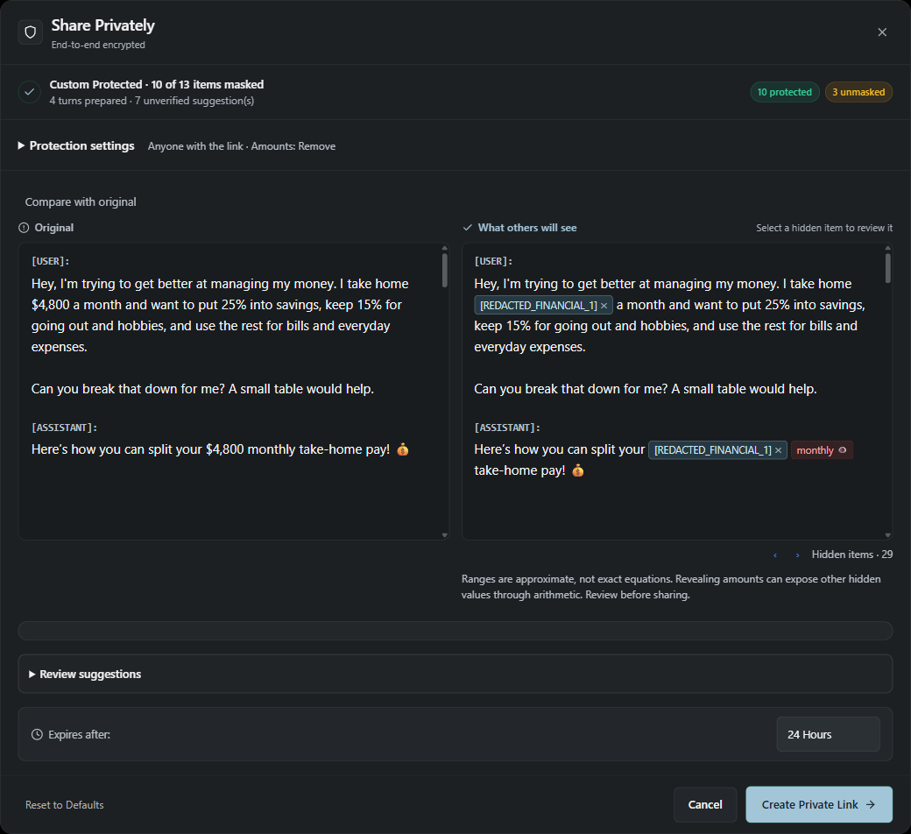
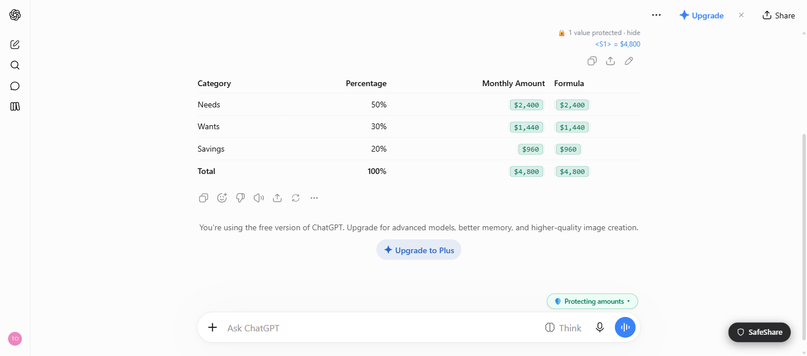
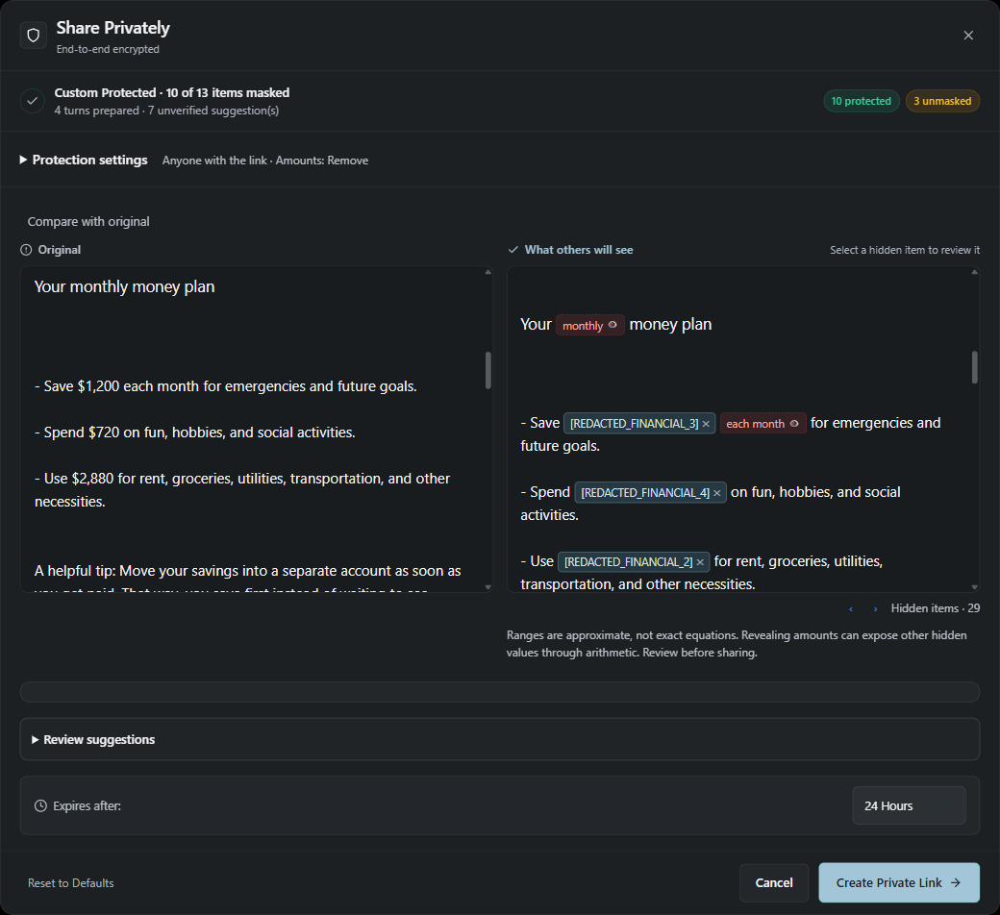
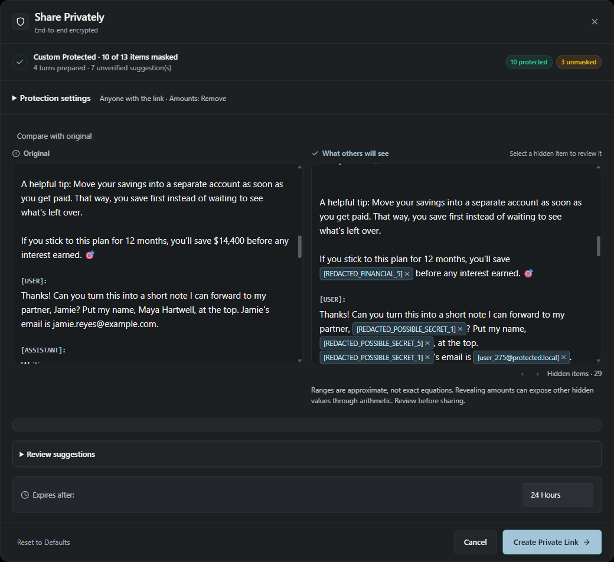
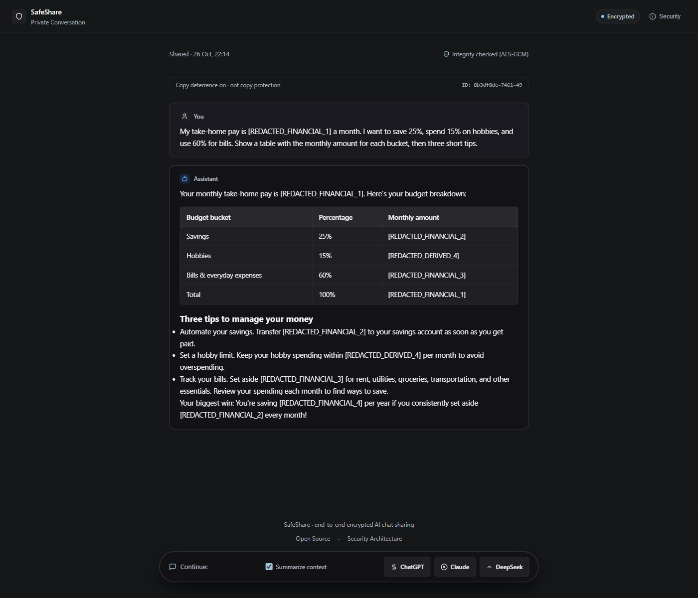
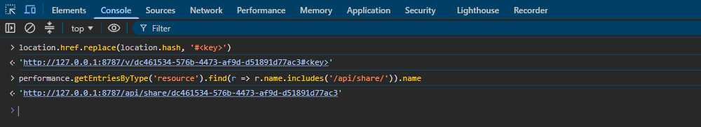
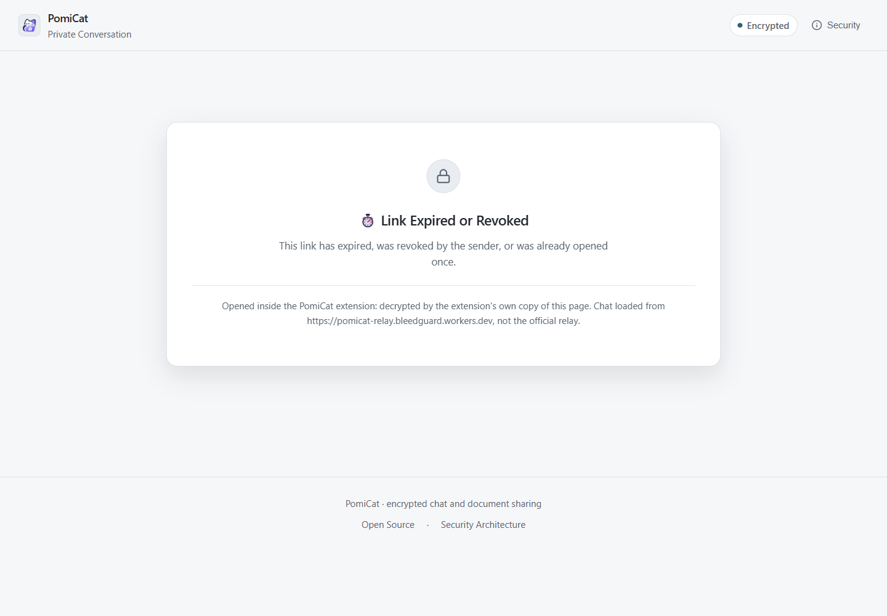
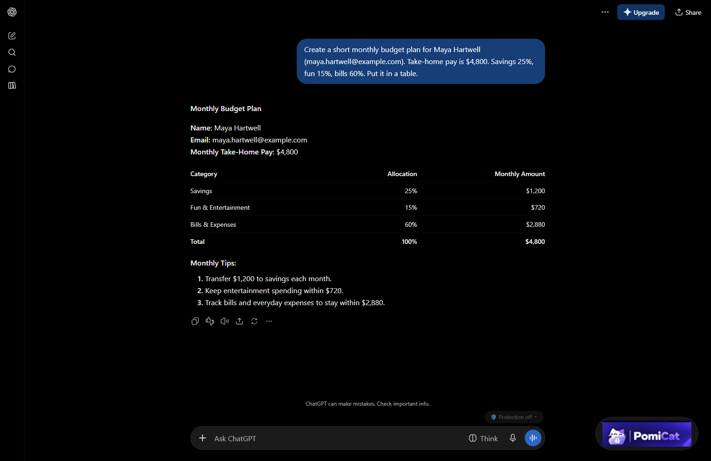
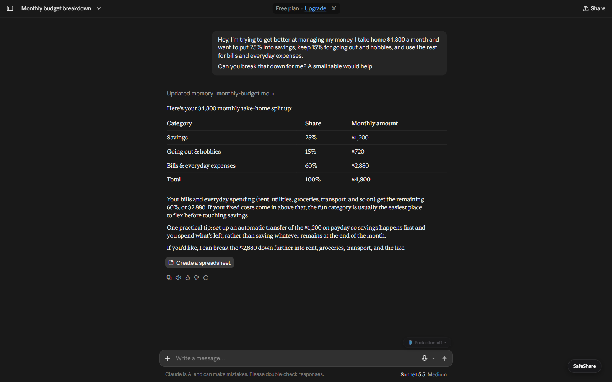
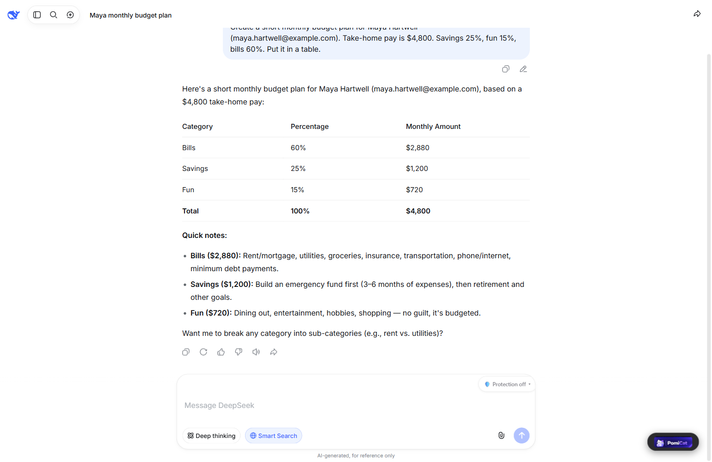

# safeshare

**Review and privately share AI conversations, with checks for sensitive data and arithmetic recovery of redacted values.**

SafeShare's main workflow is **Share Privately**: review a conversation, redact sensitive spans
and supported numerical clues, then publish an encrypted link with expiry, optional burn-after-read,
and revocation. The browser extension integrates with ChatGPT, Claude, and DeepSeek. A CLI and
text-redacting API proxy are also included.

The research question is straightforward: **what can a reader recover after the obvious secret
has been removed?** An assistant's savings calculation, annual total, or stated age can reveal
information that entity-only redaction leaves behind.

> Research software, not a guarantee of anonymity. Review the output before publishing.
> Detection can miss sensitive information or flag harmless text. A successful attack check
> means the supported attack found a clue; an empty result does not prove the chat is safe.

## Status

- **Current release:** `v2.5.4` (28 October 2026). Word Online documents can be reviewed, redacted,
  and shared as encrypted document links. The public relay serves the v4 document viewer.
- **Tests:** `59/59` offline regression tests pass with `npm test`; local browser structure tests also pass in Chromium and Firefox.
- **Exercised interfaces:** ChatGPT, Claude, DeepSeek, and Word Online with the unpacked Chromium
  extension. A public-relay document link was opened in a clean browser context without the
  extension. Firefox packages build from the same source; the screenshot set is Chromium-only.
- **Still open:** changed chat-site DOMs require re-verification, SharePoint capture depends on the
  tenant, and detection remains best-effort. Image text is marked by hand. The limitations below
  are part of the design, not footnotes.



*Review before sharing. The original and protected turns stay side by side, and every detected
item can be inspected or reversed before a link is created. Captured from the v2.4.0 extension on
Chrome 155 with a local relay and fictional data.*

[Quick start](#quick-start-share-privately) · [Screenshots](#screenshots) ·
[Reproduce the attack](#reproduce-the-attack) · [Security model](#security-model) ·
[Evaluation](#evaluation-and-reproducibility) · [Testing](TESTING.md) · [Deployment](DEPLOY.md)

## Quick start: Share Privately

### Chrome, Edge, and Brave

```bash
git clone https://github.com/darflashxd/safeshare.git
cd safeshare
```

1. Get the 2.5.4 Chrome ZIP from [Releases](https://github.com/darflashxd/safeshare/releases), or
   clone the repository and use the `extension/` folder while developing. Extract the ZIP.
2. Open `chrome://extensions`, enable **Developer mode**, select **Load unpacked**, and choose the
   extracted folder (or the repository's `extension/` folder).
3. Open or refresh ChatGPT, Claude, DeepSeek, or a Word Online document. On Word, use the floating
   **SafeShare** button at the bottom right.
4. Review the extracted text or saved document copy. In Word, the **Maybe important** section shows
   only model suggestions; automatic rule detections stay active and can be clicked in either
   preview pane to redact or restore them.
5. Choose the reader profile, amount handling, and expiry, then create the link or download the
   DOCX. Anyone receiving the **complete link, including its fragment**, can open it; recipients do
   not need the extension when the public relay serves the document viewer.

The model, vocabulary, and ONNX WASM runtime are bundled in the repository. **Running the browser
extension requires no Python, model download, or inference API key.** Creating and opening relay
shares requires a reachable relay; local detection and model inference run on your device.

Existing unpacked installations: run `git pull origin main`, reload SafeShare in the extensions
page, and refresh your chat tabs. Pulling source does not reload code already running in a tab.

### Firefox

Use a Firefox package from [Releases](https://github.com/darflashxd/safeshare/releases) if one is
published, or build the packages locally with Python 3:

```bash
python tools/build_extension.py
```

Extract `dist/SafeShare-<version>-firefox.zip`. Open
`about:debugging#/runtime/this-firefox`, select **Load Temporary Add-on**, and choose the extracted
`manifest.json`. Temporary add-ons must be reloaded after a browser restart. The repository's
`extension/manifest.json` is for Chromium, not Firefox.

The build also produces a Chrome ZIP and `dist/SHA256SUMS`. **`dist/` is ignored by Git:** a clone
or pull contains the bundled model and source, not locally generated release ZIPs. See
[TESTING.md](TESTING.md) for cross-browser checks.

### Optional protection before sending

The chip above the composer controls a separate, opt-in feature. Its default is **Off (send as typed)**.

| Mode | Intended behavior |
|---|---|
| Off | Send the prompt as typed; Share Privately remains available. |
| Protect amounts only | Replace supported personal amounts with symbolic parameters such as `<S1>` and `<S2>`. |
| Protect IDs + amounts | Also replace supported identifiers and credentials; use the local model for names and places tied to the writer when available. |

Supported formulas in AI replies can be evaluated locally against the symbolic values. This is
not a general computer algebra system, and arbitrary model-generated formulas may be unsupported.
Original-value restoration depends on the browser session mappings remaining available.

**Before-send protection is not a barrier against the chat site's JavaScript reading the composer
while you type.** It changes what is submitted, not what the page could already observe.



*The prompt was sent as `<S1>`. The note under the message keeps the mapping on this screen only,
and the reply's formulas are computed locally against it. The chat site received `<S1>`, not
`$4,800`. Captured from the v2.4.1 extension on Chrome 155, ChatGPT dark theme, with a local relay;
the reply and its computed values are unedited.*

### Word Online integration

The launcher appears on Word editor routes (`Doc.aspx`/`doc2.aspx`) without a per-site prompt;
the toolbar opens Word Online setup. Opening it reads a **separate copy** of the saved document
through the current SharePoint session, leaving the original unchanged. The setup page is a
document-first workspace: the preview spans the width at the top (original beside “what others
will see”), followed by the Maybe important section, then images, then sharing. A sticky section nav
jumps between the sections. Maybe important lists only model suggestions, labelled
`Possible person - Model score 78%`, six at a time with **Show more**. Rule detections stay
automatic and are not listed; click any highlight in either pane to redact or restore it.
Selecting other text adds a manual redaction, and scrolling one pane follows the other. Opening
setup from the launcher reads the copy once automatically; the control then becomes **Read again**.

Detection reuses the chat tiers plus money-column/currency bases and the derived-amount solver,
with local NER for names. Rule results are applied automatically; model suggestions show their NER
label and score and can be toggled per item. Redaction is surgical OOXML editing — `w:t` runs are
rewritten inside the original package, so tables, styles, headers, footers and equations survive.

Images are reviewed at full size in a lightbox: drag to mark areas or replace the whole image.
Pixels are overwritten and re-encoded, then verified before export. A crop can still contain the
hidden area in the file, so **Redact whole** is the safe choice when unsure.

After applying, the verified DOCX can be downloaded or shared as an encrypted link (24h/3d/7d,
revocable). The key stays in the link fragment; the relay stores ciphertext only. The current relay
limit is 512 KiB ciphertext, so image-heavy documents should be downloaded instead. When the
attack check still recovers hidden amounts, creating a link requires an explicit confirmation.

Limits: text inside images is not detected automatically (mark it yourself), charts and OLE objects
are counted but not rewritten, and SharePoint session-download compatibility is tenant-dependent.

## Screenshots

### Hiding the original value is not enough

The assistant still shows the numbers derived from the salary. Redacting `$4,800` does not hide
`$1,200` at 25%, `$720` at 15%, `$2,880` at 60%, or the `$14,400` annual total.



*The salary is masked, but the monthly allocations are also recoverable values. SafeShare reviews
them together.*



*`$14,400 ÷ 12 = $1,200` and `$1,200 ÷ 25% = $4,800`. The annual total is a second path to the
hidden salary. The three unmasked suggestions in these captures are date-like false positives
(`monthly`); the salary and its derived amounts are masked.*

### The recipient view



*The recipient sees the reviewed conversation, not the owner's local restoration mapping. This
capture uses the v2.4.1 relay-served viewer with the extension disabled, so no originals are
available in the page. The conversation runs to its last line and the **Continue** bar stays
visible.*

### Where the key lives



*A share URL is `<relay>/v/<id>#<key>`. The part after `#` is the AES-256-GCM key, and the browser
does not put it on the wire: the page's own request for the ciphertext is `/api/share/<id>`, with no
fragment. The key is redacted in this capture; both URLs are the page's console output on v2.4.1
against the local relay.*

Search engines do not index or fetch anything behind `#`, and the relay also sends
`X-Robots-Tag: noindex`. Both are defence in depth, not access control: a full link posted in
public can still be copied, and anyone holding it can decrypt the share until it expires or is
revoked.

### Revocation



*The owner can revoke a link after creating it. Revocation blocks subsequent retrieval; it cannot
recall copies a recipient has already retained. This link points at the local relay used for the
capture.*

### Supported chat interfaces

<details>
<summary>ChatGPT, Claude, and DeepSeek</summary>

**ChatGPT**



**Claude**



**DeepSeek**



</details>

All captures use fictional conversations, Chrome 155, and a relay at
`http://127.0.0.1:8787`. The review, derived-amount, revocation, and platform captures were taken
with v2.4.0; the before-send and recipient-view captures were retaken with v2.4.1, and the
fragment-boundary capture was taken with v2.4.1. No mock UI or screenshot slideshow is used.

## Reproduce the attack

Requirements: Node.js 18 or newer. These examples use fictional data and need neither a model
nor a relay.

```text
User: My salary is <SALARY> a month. If I save 20%, how much is that per month and per year?
Assistant: Saving 20% means $1,000 per month, leaving $4,000 for expenses.
           Over a year that adds up to $12,000.
```

Removing the salary does not remove the arithmetic clue: `$1,000 / 0.20 = $5,000`.

```bash
node bin/safeshare.js invert examples/chat_naive_redacted_en.txt
```

Leading result (the tool also prints alternative candidates):

```text
Most likely hidden value: $5,000 (agreed by 3 visible numbers)
    $1,000 / 20%
    $4,000 / (100% - 20%)
    $12,000 / 12 / 20%
```

Redact the original conversation with SafeShare, then run the same attack:

```bash
node bin/safeshare.js redact examples/chat_original_en.txt | node bin/safeshare.js invert
```

```text
No hidden values recovered.
```

`invert` ranks candidate amounts using visible ratios and common periods. It also checks supported
age/birth-year and date clues; see [the birth-date example](examples/chat_birthdate_naive.txt).
These are bounded heuristics, not proof of the original value or an exhaustive inference attack.
Use the tool only on synthetic data or data you are authorized to examine.

## Capabilities and scope

| Component | Purpose | Important boundary |
|---|---|---|
| Browser extension | Conversation extraction, interactive review, manual redaction, encrypted sharing, optional before-send protection | ChatGPT/Claude/DeepSeek layouts change; inspect the extracted turns and health warnings. |
| Local NER | Additional PII suggestions and writer-linked name/place detection | BERT-small INT8, English-focused; scores are not calibrated probabilities. |
| CLI and library | Redact transcripts, test arithmetic recovery, create encrypted shares | Built-in rules, not the browser's NER model; optional Presidio integration. |
| API proxy | Redact supported text request fields before forwarding to an LLM API | Not a universal DLP gateway; images/files are not redacted and responses are not restored. |
| Relay and viewer | Store ciphertext and open expiring or revocable shares | A full share link is a bearer capability; hosted decryption trusts the serving host. |

Rules recognize supported credential, contact, banking, government-ID, location, and contextual
personal-data patterns. Checksums and context help distinguish values, but coverage is not universal.
The inversion defense additionally targets supported ratios, per-period amounts, projections,
sums, and differences across turns. It does not model every possible inference.

Review suggestions are **unverified candidates**, not confirmation that a credential works.
Some start selected through explicit credential context or the review's hand-set scoring policy.
Inspect their state instead of relying on badge color. **Reset to Defaults** restores the default
policy; **Protect All** explicitly selects uncertain suggestions too.

## How it works

```text
Conversation extraction
    Rules + contextual detection + local model suggestions
    Supported cross-turn inference checks
    User review and manual redactions
    Snapshot of reviewed roles and text
    Client-side AES-256-GCM encryption
    Ciphertext upload to relay
    Decryption in the extension viewer or hosted fallback
```

| Area | Implementation |
|---|---|
| Deterministic patterns and value boundaries | [heuristics.js](extension/engine/heuristics.js) |
| Personal/public context | [contextual.js](extension/engine/contextual.js) |
| Repeated values and numerical derivations | [pseudonymizer.js](extension/engine/pseudonymizer.js) |
| Model inference | [offscreen.js](extension/offscreen.js), Chrome offscreen document / Firefox background page |
| Review and publication | [modal.js](extension/ui/modal.js) |
| Client-side encryption | [crypto.js](extension/engine/crypto.js) |
| Cloudflare relay | [worker.js](relay/worker.js), D1 storage |

The encryption key is carried in the URL `#fragment`, which browsers do not include in HTTP
requests. The relay API receives ciphertext, not the reviewed plaintext or the fragment key.
Expiry, burn-after-read, and revocation are enforced by the relay; they cannot recall a copy
already retained by a recipient.

## Security model

| Actor or risk | Protection | Residual risk |
|---|---|---|
| Reader inferring a hidden amount | Redaction of supported numerical clues; attack check on the reviewed text | Unknown transformations, semantic clues, and deliberately revealed values may still expose information. |
| Person holding a full share link | Expiry, optional burn-after-read, revocation | The holder can decrypt while the link is usable and keep a copy. |
| Relay operator | Client-side encryption; extension-hosted viewer avoids executing a relay-served decryptor | IPs, timing, share IDs, and sizes remain visible. A modified hosted fallback can steal its key/plaintext. |
| Search engines and link previews | Ciphertext API, indexing directives, user-initiated opening | `noindex` is not access control. Click-to-open reduces accidental consumption, not all automated access. |
| Chat provider | Optional rewrite at submission | Typed text is visible to the page before submission; the provider retains anything already received. |
| Changed chat-site layout | Extraction health checks and review UI | Missing turns or submit-hook changes still require real-site testing. |

With SafeShare installed on a supported relay origin, share links are routed to the extension's
own viewer. Without it, recipients use the hosted viewer and must trust its operator. CSP is
defense in depth, not protection against a host that controls both the page and its headers.

### Known limitations

- Phrasing and formats outside the detectors' coverage can be missed. English is the local model's
  focus; non-English and mixed-language quality is not assured. No language-word shortcut disables
  the full scan, and an empty successful scan means **checked**, not **safe**.
- The CLI/proxy do not run the bundled browser model. Personal-name rules alone are not general NER.
- Text in images, arbitrary attachments, and every field in pasted logs/HAR files are not covered.
- Quasi-identifiers and semantic re-identification are not comprehensively prevented.
- Restored amounts are ordinary page text and may be read by site scripts. Closed-shadow rendering
  for some other restored values is not a security boundary against a compromised browser or
  another privileged extension. Session mappings can disappear after browser/extension lifecycle
  changes; SafeShare cannot reconstruct originals that were not sent to the AI.
- The optional sharer-originals feature stores a separate encrypted restoration copy on the
  creator's device; ordinary recipients do not receive that private mapping. See [the changelog](CHANGELOG.md).
- Copy deterrence is not copy protection. Screenshots, photographs, or an authorized reader's own
  tools can retain displayed content. Burn-after-read does not stop this.
- Malware, a compromised browser/extension, and compromised distribution accounts are outside the
  protection provided by redaction and link encryption.

If a live credential has already been sent to a service, rotate or revoke it. Redacting a later
share does not remove it from the original service or from copies already made.

## Evaluation and reproducibility

**Regression success is not a detection-accuracy measurement.** Model-only, pipeline, and attack
results answer different questions and must not be combined into one security score.

| Evidence | What it measures | Qualification |
|---|---|---|
| [Candidate model comparison](tools/eval/MODEL_COMPARISON.md) | MiniLM, BERT-small INT8, and GLiNER experiments; native/WASM measurements | Small development set plus external synthetic data; not a guaranteed unseen holdout. |
| BERT external EN experiment | Exact-span F1 0.952 on 500 Gretel documents / 963 canonical name, location, email, and phone entities | Common-label model evaluation, not all PII or the production pipeline. Thirteen entities were only partially covered. Dataset overlap with training is unknown. |
| [Earlier CLI/Presidio evaluation](tools/eval/RESULTS.md) | Historical detector utility and inference experiments | Different configurations and metrics; not the current browser model's score. |
| [Attack benchmark](tools/attack_bench/RESULTS.md) | Arithmetic recovery from 40 fictional templated chats | Tests supported transformations, not arbitrary AI output or real-world prevalence. |
| [Regression and browser checks](TESTING.md) | Known bugs, UI choices, runtime execution, preview/payload consistency | A model loading successfully does not establish held-out precision or recall. |

The earlier WildChat investigation found few personal-finance disclosures and no demonstrated
inversion incident in that sample. It does not establish that the attack is common in real chats;
see [the evaluation report](tools/eval/RESULTS.md).

The bundled model is `gravitee-io/bert-small-pii-detection` INT8, with 51 BIO labels and a
30,522-token vocabulary. Weights are approximately 28.7 MB. The legacy filename
`model_q4.onnx` does **not** indicate the current quantization format. Revision, SHA-256, and
language scope are recorded in [MODEL_INFO.json](extension/models/MODEL_INFO.json) and
[MODELS_SETUP.md](MODELS_SETUP.md). Benchmark latency depends on the input, hardware, and runtime;
short pre-tokenized kernel timings are not end-to-end share-review latency.

## CLI, library, and proxy

Node.js 18+, no third-party runtime dependencies for the built-in CLI path:

```bash
node bin/safeshare.js redact examples/chat_original_en.txt
node bin/safeshare.js invert examples/chat_naive_redacted_en.txt
node bin/safeshare.js redact examples/chat_original_en.txt --numbers range
```

Input is plain text with `User:` / `Assistant:` lines, or a JSON array of `{role, content}`.
`npm link` installs the `safeshare` command from your checkout. The library exports
`redactTurns` and `invert` through `require("safeshare-ai")` after local installation.

| Reader profile | Intended policy |
|---|---|
| `--profile public` (default) | Remove detected identifiers, personal details, supported personal amounts, and derivable numerical clues. |
| `--profile trusted` | Keep personal amounts/names according to the profile; still remove supported hard identifiers and credentials. |

`--numbers range` generalizes eligible personal amounts. Revealing an exact amount or using a
more permissive profile can make another hidden value inferable. Always review the result.

### API proxy

```bash
node bin/safeshare.js proxy --port 8788 --upstream https://api.openai.com
```

Point your client at `http://127.0.0.1:8788/v1` and supply the authentication needed by your
upstream provider. Supported text request formats include OpenAI Chat Completions, OpenAI
Responses, and Anthropic Messages. Unsupported body-bearing endpoints are refused; unsupported
tool or multimodal structures can also be rejected instead of forwarded without protection.
Responses are not restored. Use fictional requests when testing a live provider.

### Optional Presidio integration and policy

The CLI/proxy can use a separately running Presidio analyzer:

```bash
node bin/safeshare.js redact chat.txt --presidio http://127.0.0.1:5002
```

Start an analyzer first; [tools/presidio_server.py](tools/presidio_server.py) is the project's
optional server entry point and requires Presidio plus its NLP model. Unlike bundled browser
inference, this sends text to the configured analyzer, so use a trusted endpoint.

```json
{
  "profile": "public",
  "numbers": "range",
  "disable": ["SYSTEM"],
  "allow": ["support@example.org"],
  "rules": [{"id": "TICKET", "pattern": "ACME-\\d{6}", "replacement": "[TICKET]"}]
}
```

Pass with `--policy policy.json`. Allowlisting, disabled categories, and custom rules change
what remains visible. Presets named `pci`, `hipaa`, or `gdpr` are category filters, **not compliance
certifications**.

## Relay and self-hosting

For a local demonstration, start the relay in one terminal:

```bash
python relay/server_local.py
```

Then create a fictional share in another terminal:

```bash
node bin/safeshare.js share examples/chat_original_en.txt --burn --ttl 3600 --relay http://127.0.0.1:8787
```

This uploads an encrypted test share to your local relay. The CLI prints the link and a revocation
command. Treat the fragment key and revocation token as secrets; do not include real links in bug
reports. The browser extension defaults to the project's hosted relay; running a local server
does not automatically change that setting.

Cloudflare Worker/D1 deployment, schema upgrades, relay restrictions, and custom-host changes:
[DEPLOY.md](DEPLOY.md). API entry points are `POST /api/share`, `GET /api/share/:id`, and
`POST /api/revoke/:id`. Re-deploying hosted assets is separate from pushing Git commits.

## Development and testing

```bash
npm test
python tools/eval/test_score.py
python tools/build_extension.py
```

Browser harnesses require their documented test dependencies; they are not requirements for
using the installed extension:

```bash
python tools/eval/credential_browser.py
python tools/eval/chrome_ner.py
python tools/eval/firefox_ner.py
```

Use fictional data. Include the browser/OS, extension commit, active mode, minimal reproduction,
and expected behavior when reporting a bug. Do not publish passwords, full share links, tokens,
or private transcripts. Repository issues are not a confidential reporting channel.

| Resource | Contents |
|---|---|
| [TESTING.md](TESTING.md) | Regression commands, browser fixtures, limitations, installation checks |
| [MODELS_SETUP.md](MODELS_SETUP.md) | Model provenance, runtime, and research-only models |
| [DEPLOY.md](DEPLOY.md) | Local/Cloudflare relay setup and upgrades |
| [DEMO.md](DEMO.md) | Demonstration walkthrough |
| [CHANGELOG.md](CHANGELOG.md) | Changes and security corrections |
| [ROADMAP.md](ROADMAP.md) | Open work and research questions |

## License and attribution

SafeShare source is licensed under [Apache-2.0](LICENSE). The bundled BERT-small PII model is
published by [Gravitee](https://huggingface.co/gravitee-io/bert-small-pii-detection) under
Apache-2.0 as declared upstream. Bundled runtimes and optional dependencies retain their own
licenses; see [bundled attribution and license texts](extension/THIRD_PARTY_NOTICES.md).
Chrome/Firefox ZIPs include the project license and bundled third-party notices.
Cite the exact SafeShare
commit, model revision, dataset, and evaluation configuration when reporting research results.
