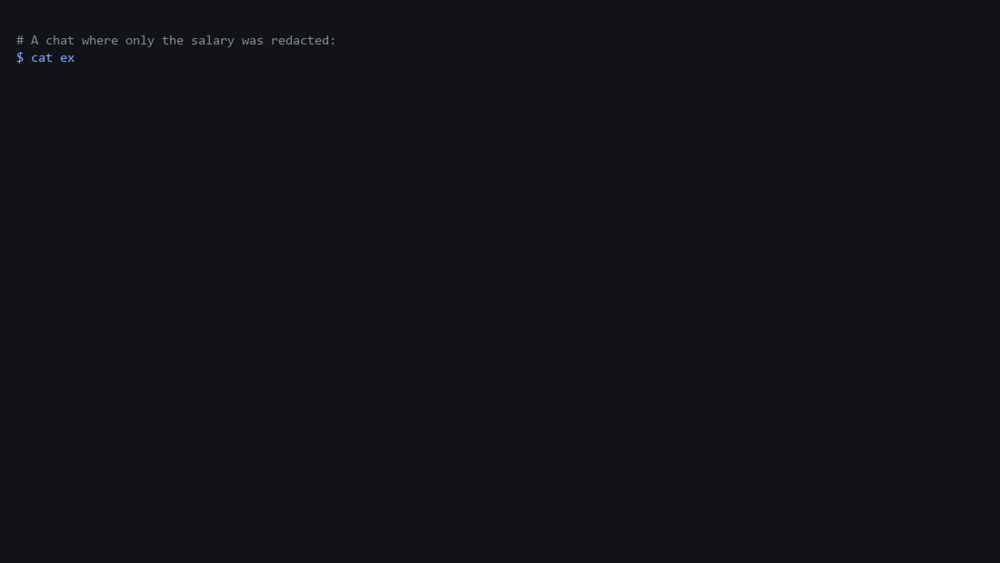

# SafeShare

Redaction leaks. SafeShare finds what the redaction left behind.

When you share an AI chat, removing the obvious secret is not enough. If you redact your salary
but the assistant's answer still says "saving 30% gives Rp 900.000 a month, Rp 10.800.000 a
year", anyone can work the salary back out: 10.800.000 / 12 / 30% = 3.000.000.

SafeShare is three things:

1. **An inversion attack** (`safeshare invert`) that recovers hidden numbers from chats that were
   already redacted by any tool.
2. **A redactor** that removes personal data and the derived numbers that would give it away,
   for ChatGPT, Claude and DeepSeek (browser extension) or any text (CLI, proxy).
3. **An encrypted share link.** The chat is encrypted in your browser with AES-256-GCM, and the
   key stays in the URL `#fragment`, which browsers do not send to the server. Links expire,
   can burn after one read, and can be revoked.



## Try the attack

```bash
git clone https://github.com/darflashxd/safeshare && cd safeshare
node bin/safeshare.js invert examples/chat_naive_redacted.txt
```

```
Most likely hidden value: Rp 3.000.000 (agreed by 3 visible numbers)
    Rp 900.000 / 30%
    Rp 2.100.000 / (100% - 30%)
    Rp 10.800.000 / 12 / 30%
```

Then redact with SafeShare and attack again:

```bash
node bin/safeshare.js redact examples/chat_original.txt | node bin/safeshare.js invert
# No hidden values recovered.
```

The attack looks for one value that several visible numbers agree on, using ratios found in the
text and common periods (months, weeks, quarters, years), and ranks candidates by how simple the
explanation is. It does the same for dates: a hidden birth date comes back from "I am 28" or
"I graduated in 2020 at 22" (`examples/chat_birthdate_naive.txt`). Use it on synthetic data or
data you own.

How often this happens in real chats is still open: in 20,000 WildChat conversations, people
almost never shared their own finances, and nothing leaked in the few that did
([details](tools/eval/RESULTS.md#6-does-the-inversion-attack-happen-in-real-chats-2026-10-11)).

## How redaction works

| Layer | What it does | Code |
|---|---|---|
| Pattern rules | Regex plus checksums: Indonesian NIK/NPWP/BPJS, cards (Luhn), IBAN, API keys, DB URIs, JWTs, seed phrases, shell prompts and home paths, 20+ national IDs | `extension/engine/heuristics.js` |
| Contextual rules | Separates "my salary" / "gaji saya" from "the average salary" / "rata-rata gaji". Rule-based, no ML model. | `extension/engine/contextual.js` |
| Inversion defense | Normalises numbers across formats (`10,8 juta`, `10.8M`, `Rp 10.800.000`), then removes every visible number that can be derived from a redacted one. Ratios such as 30% are kept, because on their own they reveal nothing. | `extension/engine/pseudonymizer.js` |

Redacted values become consistent placeholders (`[REDACTED_FINANCIAL_1]`) across the whole
conversation, so the chat still reads naturally.

## Threat model

| Who | What they can do | What SafeShare does |
|---|---|---|
| Search engines and crawlers (Google dorking) | Index any share page they find a link to | The server and the page only hold ciphertext; the key is in the `#` part of the link, which browsers never send. `noindex` headers on every response. |
| Scrapers guessing links | Try share IDs in bulk | IDs are random UUIDs (122 bits), and reads are rate-limited per IP. |
| Anyone who gets the full link (forwarded, pasted in a public channel) | Read the shared chat | Redaction before sharing, so there is little to read; burn after one view, expiry, and revoke limit how long it's readable. |
| A reader doing arithmetic on the shared chat | Recover a redacted amount from the numbers around it | The inversion defense removes every derivable figure; `invert` checks it. |
| The relay operator (Cloudflare, or whoever deploys it) | See ciphertext, IP addresses, timing, sizes | Can't read content. Metadata is visible. |
| The AI vendor | See whatever you send it | Before-sending protection replaces IDs and amounts (`<S1>`) while you chat; names are still sent. |

**Out of scope:** malware or a compromised browser on your machine, a recipient who screenshots
the page, and what the vendor already received before you installed SafeShare. The viewer's
anti-copy features are deterrence only, not protection.

### "Didn't the vendors fix this?"

After shared chats showed up in search results in 2025, vendors removed "make discoverable"
options and added `noindex`. That stops search listings, but a vendor share link is still a page
that serves the whole plaintext chat to anyone holding the link, stored by the vendor and usually
without expiry. Shared links get forwarded, pasted into public channels and archived. SafeShare
removes the personal details (including derivable numbers) before anything is shared, encrypts so
the host can't read it, and lets links expire.

## Measured accuracy

Full method and per-label numbers: [tools/eval/RESULTS.md](tools/eval/RESULTS.md).

| | ai4privacy token F1 | real chats touched (WildChat) | hidden salary recoverable |
|---|---|---|---|
| SafeShare alone | 0.21 | 7.8% | no |
| SafeShare + Presidio, `names: personal` (default) | 0.31 | 8.8% | no |
| SafeShare + Presidio, `names: all` + dates | 0.78 | 71% | no |
| Presidio alone | 0.79 | – | yes |

- **Alone, SafeShare is not a general PII detector.** It has no named-entity recognition. With
  `--presidio` it uses Presidio for names, places, phones and IDs, and with every name and date
  turned on it matches Presidio (0.78 vs 0.79) while also blocking the inversion attack.
- **Benchmarks and real chats disagree about names.** ai4privacy labels every name as PII; real
  chats are full of names that aren't the user's (celebrities, story characters, authors). Turning
  all names on touches 71% of real conversations. The default, `names: personal`, only redacts a
  name or place tied to the user ("my wife Rina", "I live in Bandung") and touches 8.8%.
- Deciding whether a name or number belongs to the user is the part that needs a trained
  model; the rules here are the stopgap.
- The test suite in `tests/` is a regression suite written alongside the rules, not an accuracy
  measurement.
- The test suite in `tests/` is a regression suite written alongside the rules, not an accuracy
  measurement.

## Limits

- Detection is rule-based. Phrasing the rules don't cover will be missed. A DistilBERT model
  was trained and scored F1 0.64 on held-out data, so it isn't shipped ([MODELS_SETUP.md](MODELS_SETUP.md)).
- Social-media handles in casual phrasing ("follow me at @name") are not caught.
- Anyone holding the full link can read the share. The viewer's anti-copy features (glyph
  scrambling, zero-width watermark, DevTools check) are deterrence only: a screenshot defeats them.
- Not covered yet: text inside images, cookies in pasted HAR files, combinations of
  quasi-identifiers (job + city + company size).

## Install

### Browser extension (Chrome, Edge, Brave, Firefox)

Download the zip from [Releases](https://github.com/darflashxd/safeshare/releases), or use
the `extension/` folder directly.

- **Chrome / Edge / Brave:** copy `extension/manifest.chrome.json` over `extension/manifest.json`
  (the default manifest is the Firefox one), open `chrome://extensions`, turn on Developer mode,
  click "Load unpacked" and choose the `extension/` folder. The Chrome release zip already has
  the right manifest.
- **Firefox:** open `about:debugging#/runtime/this-firefox`, click "Load Temporary Add-on" and
  choose `extension/manifest.json`.

Open chatgpt.com, claude.ai or chat.deepseek.com and click the SafeShare button to review the
redactions and create a link.

### CLI and library (Node 18+, no dependencies)

```bash
node bin/safeshare.js redact chat.txt
node bin/safeshare.js invert redacted.txt        # exit code 2 if something was recovered
node bin/safeshare.js share chat.txt --burn --ttl 3600 --relay http://127.0.0.1:8787
```

`npm link` (or `npm i -g .`) installs it as `safeshare`.

Input is plain text with `User:` / `Assistant:` lines, or a JSON array of `{role, content}`.

```js
const { redactTurns, invert } = require("safeshare-ai"); // after npm install <path-to-repo>
```

### Proxy for OpenAI-compatible APIs

```bash
node bin/safeshare.js proxy --port 8788 --upstream https://api.openai.com
# then point your SDK at http://127.0.0.1:8788/v1
```

Every chat message is redacted before it leaves your machine. Responses are not restored.

### Who will read it, and how to show amounts

| | `--profile public` (default) | `--profile trusted` |
|---|---|---|
| Keys, IDs, cards, contacts | removed | removed |
| Your own amounts and anything derived from them | removed (or a range) | kept |
| Your name, family, places tied to you | removed | kept |

`--numbers range` shows your own amounts as a band instead of a placeholder: "Gaji saya
Rp 3.000.000" becomes "Gaji saya Rp 2–5 juta". Derived figures stay removed, and the range is
only used if `invert` can't recover the original from it. The extension has the same two
choices ("Reader" and "Amounts") in the share dialog.

### Advanced (CLI only): Presidio for names, places and IDs

SafeShare works without this. It's an optional extra for the CLI and proxy when you also want
general name and address detection, and it's what the evaluation numbers above use.

```bash
pip install presidio-analyzer && python -m spacy download en_core_web_lg
python tools/presidio_server.py                      # or the official presidio-analyzer Docker image
node bin/safeshare.js redact chat.txt --presidio http://127.0.0.1:5002
```

In a policy file: `"presidio": { "url": "...", "names": "personal" | "all", "skip": ["DATE_TIME", "NRP", "URL"] }`.
Presidio's default model is English, so Indonesian names are only caught by SafeShare's own
rules ("nama saya …"). The browser extension can't use Presidio (it's Python); a small name
model running inside the browser is on the roadmap instead.

### Policy file

```json
{
  "profile": "public",
  "numbers": "range",
  "presidio": "http://127.0.0.1:5002",
  "preset": "pci",
  "disable": ["SYSTEM"],
  "allow": ["support@acme.com", "/^ACME-INTERNAL-\\d+$/"],
  "rules": [{ "id": "ACME_TICKET", "pattern": "ACME-\\d{6}", "replacement": "[TICKET]" }]
}
```

Pass it with `--policy policy.json` to `redact`, `share` or `proxy`. Presets (`pci`, `hipaa`,
`gdpr`) limit redaction to the relevant categories. They help with scoping; they are not
compliance certifications.

## Relay

The relay stores ciphertext only.

- **Local / offline:** `python relay/server_local.py` serves the API and the viewer on
  `http://127.0.0.1:8787`.
- **Cloudflare:** step-by-step in [DEPLOY.md](DEPLOY.md) (free plan, about 15 minutes).

API: `POST /api/share` `{id (UUID), ciphertext, ttl, burn_on_read}` returns a `revoke_token`.
`GET /api/share/:id` returns the ciphertext. `POST /api/revoke/:id` `{token}` deletes the share.

Limits: shares up to 512 KB, 10 uploads and 60 reads per minute per IP (both relays), and
expired shares are deleted daily.

## Development

```bash
npm test                                   # all tests in tests/
python data/generate_dataset.py            # regenerate the synthetic training data (seeded)
python tools/build_extension.py            # dist/SafeShare-<version>-chrome.zip and -firefox.zip
python tools/make_demo_gif.py              # docs/demo.gif (start relay/server_local.py first for the share step)
```

```
bin/        CLI, library entry point, proxy
extension/  browser extension (engine/, ui/)
viewer/     share-link viewer page
relay/      Cloudflare Worker, D1 schema, local Python relay
examples/   synthetic chats for the demo
tests/      regression tests
tools/      evaluation harness (tools/eval), benchmarks, demo scripts
training/   DistilBERT experiment (not shipped)
docs/       Arsenal abstract; docs/archive has older notes
```

See [DEMO.md](DEMO.md) for the booth walkthrough.

## License

Apache 2.0
