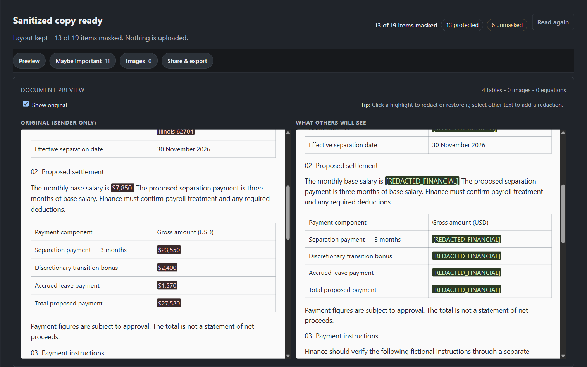
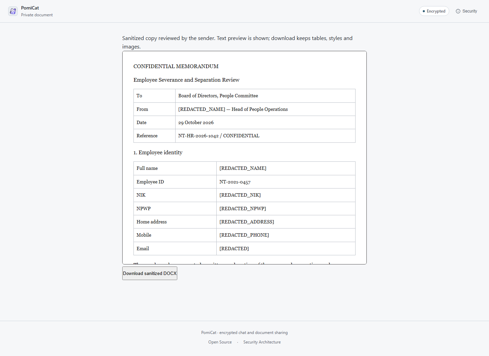
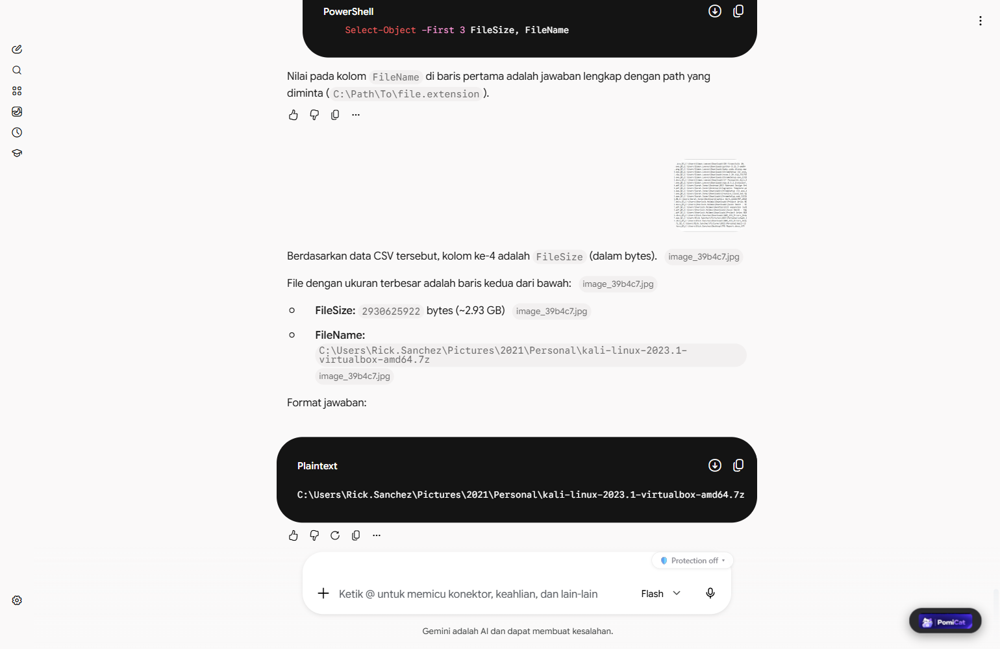

# PomiCat

[](https://github.com/darflashxd/pomicat/actions/workflows/test.yml)
[](LICENSE)
[](https://github.com/darflashxd/pomicat/releases)

### Share the content. Not the secrets.

A useful AI chat can also contain your salary, a client's name, or a password pasted by mistake.
A Word document can carry the same details into someone else's hands.

PomiCat lets you review the copy, redact sensitive information, and share it through an encrypted
link. It works with ChatGPT, Claude, Gemini, DeepSeek, and supported Word Online documents.

Previously SafeShare, then Blackline. The rename keeps the extension identity, saved settings,
the encrypted link format, and the older relay hosts working.

[Download extension](https://github.com/darflashxd/pomicat/releases) ·
[Get started](#quick-start-share-privately) · [Screenshots](#screenshots) · [Demo walkthrough](DEMO.md)

| AI conversations | Word documents |
|---|---|
|  |  |
| Check what the recipient will see. | Review employee details and settlement figures before sending the copy. |

*Fictional examples, shown in separate product views. Captures use PomiCat v3.0.0 with fictional
data and a local or hosted relay. [Chat capture details](#supported-chat-interfaces) ·
[Word capture details](#word-review-and-recipient-copy).*

Detection runs on your device. Sharing uploads an encrypted copy to a relay.

> Detection can miss things. Check the redacted copy before sharing.

## Choose what others see

- **Check the copy side by side.** Inspect each highlight, restore a selection, or mark something
  the detectors missed. You make the final call on what stays visible.
- **Look beyond the original value.** A percentage, subtotal, or annual figure can reveal a number
  you already hid. PomiCat checks supported arithmetic relationships as well as direct identifiers.
- **Send a copy, not the original.** Share a reviewed chat or sanitized DOCX through an encrypted
  link. Set an expiry or revoke future access. Chat links also offer burn-after-read.

Share Privately does not edit the source chat or Word document. Recipients do not need the
extension, but the hosted viewer must be trusted with decryption. Anyone holding the complete
link can read the copy and save it; expiry and revocation cannot recall saved copies.

## Hiding a number isn't always enough

Redact a salary, but leave the savings calculation, and the salary is still there for anyone
willing to do the math:

```text
Salary: [REDACTED]
Assistant: Saving 20% gives $1,000 a month.

$1,000 / 0.20 = $5,000
```

PomiCat checks for numerical clues like these, so you can review the calculations as well as
the original amount. It covers specific arithmetic relationships, not every possible inference.
[See the example](#hiding-the-original-value-is-not-enough) or [try it offline](#try-the-attack-offline).

## Quick start: Share Privately

### Chrome, Edge, and Brave

```bash
git clone https://github.com/darflashxd/pomicat.git
cd pomicat
```

1. Use the latest published Chrome ZIP from [Releases](https://github.com/darflashxd/pomicat/releases), or
   clone the repository and use the `extension/` folder while developing. Extract the ZIP.
2. Open `chrome://extensions`, enable **Developer mode**, select **Load unpacked**, and choose the
   extracted folder (or the repository's `extension/` folder).
3. Refresh any chat or Word tabs that were already open, then follow
   [Create your first private share](#create-your-first-private-share).

The model, vocabulary, and ONNX WASM runtime are bundled in the repository. **Running the browser
extension requires no Python, model download, or inference API key.** Creating and opening relay
shares requires a reachable relay; local detection and model inference run on your device.

Existing unpacked installations: run `git pull origin main`, reload PomiCat in the extensions
page, and refresh your chat tabs. Pulling source does not reload code already running in a tab.

### Create your first private share

1. Open a short fictional conversation in ChatGPT, Claude or DeepSeek, then click **PomiCat**.
   For Word, open a saved fictional DOCX and click the floating **PomiCat** button.
2. Check that the expected messages or document content were captured. Compare the original and
   protected previews, inspect suggestions, and manually select anything the detectors missed.
3. For Word, choose **Create sanitized DOCX** and wait for verification. Review images manually.
   Choose an expiry and create the private link when the reviewed copy is ready.
4. Open the complete link in a separate browser context, click the opening button and check the
   recipient's copy. Without the extension, the hosted viewer requires trust in its operator.
5. Revoke the test link and check that a fresh retrieval is refused. Revocation cannot recall
   copies already saved by a recipient. Never publish full links or revoke tokens in bug reports.

Use only fictional data for this first run. An empty attack check means the supported checks
found no reconstruction; it does not certify the copy as anonymous.

### Updating and name compatibility

Previously SafeShare, then Blackline. The extension retains its identity and legacy settings so an
update does not reset the installation. New links use
`https://pomicat-relay.bleedguard.workers.dev`; the older relay hosts remain supported so existing
links keep opening. The npm package is `pomicat`, and the `pomicat`, `safeshare`, and `blackline`
commands all point at the same CLI. No account or relay migration is required to use the new name.

### Firefox

Use a Firefox package from [Releases](https://github.com/darflashxd/pomicat/releases) if one is
published, or build the packages locally with Python 3:

```bash
python tools/build_extension.py
```

Extract `dist/PomiCat-<version>-firefox.zip` (older releases use `PomiCat-`). Open
`about:debugging#/runtime/this-firefox`, select **Load Temporary Add-on**, and choose the extracted
`manifest.json`. Temporary add-ons must be reloaded after a browser restart. The repository's
`extension/manifest.json` is for Chromium, not Firefox.

The build also produces a Chrome ZIP and `dist/SHA256SUMS`. **`dist/` is ignored by Git:** a clone
or pull contains the bundled model and source, not locally generated release ZIPs. See
[TESTING.md](TESTING.md) for cross-browser checks.

### Optional protection before sending

The chip above the composer controls a separate, opt-in feature. Its default is **Off (send as typed)**.

| Mode | Intended behavior |
|---|---|
| Off | Send the prompt as typed; Share Privately remains available. |
| Protect amounts only | Replace supported personal amounts with symbolic parameters such as `<S1>` and `<S2>`. |
| Protect IDs + amounts | Also replace supported identifiers and credentials; use the local model for names and places tied to the writer when available. |

Supported formulas in AI replies can be evaluated locally against the symbolic values. This is
not a general computer algebra system, and arbitrary model-generated formulas may be unsupported.
Original-value restoration depends on the browser session mappings remaining available.

Draft mappings are isolated by provider origin and page instance. A same-page transition to a
conversation ID preserves them; an unassigned draft that undergoes full navigation cannot be
safely assigned to the new page, so its original-value restoration may be unavailable. Existing
identified chat mappings remain readable. A restored chat keeps its mappings until explicit reset
or browser session exit, not necessarily until tab closure.

**Before-send protection is not a barrier against the chat site's JavaScript reading the composer
while you type.** It changes what is submitted, not what the page could already observe.


*The prompt was sent as `<S1>`. The note under the message keeps the mapping on this screen only,
and the reply's formulas are computed locally against it. The chat site received `<S1>`, not
`$4,800`. Captured from the v3.0.0 extension on Chrome 156, ChatGPT dark theme, with a local relay;
the reply and its computed values are unedited.*

### Word Online integration

Open a saved document and click the floating **PomiCat** button. The extension reads a separate
copy through your existing SharePoint session; it does not overwrite the original.

Compare the two previews and click a highlight to redact or restore it. Select other text to add
a manual redaction. **Maybe important** lists model suggestions; automatic rule detections stay
in the previews. Model scores are not calibrated probabilities. Use **Read again** after saving
changes in Word, then create a new sanitized copy before sharing.

Word uses the shared rules, local model and numerical checks, with extra handling for currency
and money columns. Redaction rewrites text within the original DOCX package rather than rebuilding
it as plain text, preserving supported tables, styles, headers, footers and equations.

Images are reviewed at full size in a lightbox: drag to mark areas or replace the whole image.
Pixels are overwritten and re-encoded, then verified before export. A crop can still contain the
hidden area in the file, so **Redact whole** is the safe choice when unsure.

After applying, the verified DOCX can be downloaded or shared as an encrypted link (24h/3d/7d,
revocable). The key stays in the link fragment; the relay stores ciphertext only. The current relay
limit is 512 KiB ciphertext, so image-heavy documents should be downloaded instead. When the
attack check still recovers hidden amounts, creating a link requires an explicit confirmation.

Limits: text inside images is not detected automatically (mark it yourself). Unsupported embedded
charts, OLE and other rejected package parts stop export. SharePoint session-download compatibility
is tenant-dependent. Verification checks selected values in supported XML/relationship content and
selected image rectangles; it does not certify that every sensitive item was discovered. The attack
check reads text from the exported package, including headers, footers and notes, not only the
preview pane. Formatting runs within a paragraph are rejoined for this check. If the package cannot
be read, export and link creation stop; a preview-only check is not treated as successful verification.

## Screenshots

Chat screenshots show historical PomiCat builds; the Word agreement screenshots show the
installed PomiCat extension. Captions distinguish live captures from local fixtures.

### Word review and recipient copy




*Captured through Word Online and the installed PomiCat v3.0.0 extension, 31 October 2026.
The fictional separation agreement includes employee details, a settlement table and payment
instructions. Names were selected by the local model; the account number required manual
redaction. Thirteen text replacements across three package parts passed selected-value verification;
independent ZIP/XML inspection found none of the 12 checked private values. The supported attack
check found no reconstruction. This is one reviewed example, not an automatic-detection score.
The installed extension's exact source commit was not independently attested. Screenshots are
workspace crops without account identity or link keys; no review UI was fabricated. Generate the
source DOCX with `python tools/build_agreement_showcase.py <new-output.docx>`. The source document
was uploaded to the signed-in Word account; no encrypted public share was created for this capture.*



*The recipient viewer image above remains a separate local fixture captured 30 October 2026 from
source based on `635766f`, Chromium 149. It is not a recipient link for the agreement shown here.
Names were selected manually in that fixture; no tenant login or relay upload was involved.
Reproduce it with `python tools/capture_word_screenshots.py`.*

### Hiding the original value is not enough

The assistant still shows the numbers derived from the salary. Redacting `$4,800` does not hide
`$1,200` at 25%, `$720` at 15%, `$2,880` at 60%, or the `$14,400` annual total.


*The salary is masked, but the monthly allocations are also recoverable values. PomiCat reviews
them together.*


*`$14,400 ÷ 12 = $1,200` and `$1,200 ÷ 25% = $4,800`. The annual total is a second path to the
hidden salary. The three unmasked suggestions in these captures are date-like false positives
(`monthly`); the salary and its derived amounts are masked.*

### The recipient view


*The recipient sees the reviewed conversation, not the owner's local restoration mapping. This
capture opens inside the PomiCat extension's own viewer, so no originals are available in the page.
The conversation runs to its last line and the **Continue** bar stays visible.*

### Where the key lives


*A share URL is `<relay>/v/<id>#<key>`. The part after `#` is the AES-256-GCM key, and the browser
does not put it on the wire: the page's own request for the ciphertext is `/api/share/<id>`, with no
fragment. The key is redacted in this capture; both URLs are the page's console output against the
local relay.*

Browsers do not include the `#fragment` in HTTP requests. The relay also sends
`X-Robots-Tag: noindex`. `tests/relay_lifecycle.test.js` uses a Googlebot user agent to check that
HTTP responses and relay storage contain neither shared plaintext nor its key. This does not
prove a URL cannot be indexed or that a browser bot holding the full link cannot decrypt it.
Anyone holding the complete link can retrieve the share while it remains available and retain a copy.

### Revocation


*The owner can revoke a link after creating it. Revocation blocks subsequent retrieval; it cannot
recall copies a recipient has already retained. This link points at the local relay used for the
capture.*

### Supported chat interfaces

<details>
<summary>ChatGPT, Claude, Gemini, and DeepSeek</summary>

**ChatGPT**


**Claude**


**Gemini**



**DeepSeek**


</details>

All captures use fictional conversations and relay data. Platform captures were taken in Chrome with
the extension loaded; the review, derived-amount, revocation, recipient, and fragment captures use a
local relay at `http://127.0.0.1:8787`. No mock UI or screenshot slideshow is used.

## Reproduce the attack

Requirements: Node.js 18 or newer. These examples use fictional data and need neither a model
nor a relay.

```text
User: My salary is <SALARY> a month. If I save 20%, how much is that per month and per year?
Assistant: Saving 20% means $1,000 per month, leaving $4,000 for expenses.
           Over a year that adds up to $12,000.
```

Removing the salary does not remove the arithmetic clue: `$1,000 / 0.20 = $5,000`.

```bash
node bin/safeshare.js invert examples/chat_naive_redacted_en.txt
```

Leading result (the tool also prints alternative candidates):

```text
Most likely hidden value: $5,000 (agreed by 3 visible numbers)
    $1,000 / 20%
    $4,000 / (100% - 20%)
    $12,000 / 12 / 20%
```

Redact the original conversation with PomiCat, then run the same attack:

```bash
node bin/safeshare.js redact examples/chat_original_en.txt | node bin/safeshare.js invert
```

```text
No hidden values recovered.
```

`invert` ranks candidate amounts using visible ratios and common periods. It also checks supported
age/birth-year and date clues; see [the birth-date example](examples/chat_birthdate_naive.txt).
These are bounded heuristics, not proof of the original value or an exhaustive inference attack.
Use the tool only on synthetic data or data you are authorized to examine.

## Capabilities and scope

| Component | Purpose | Important boundary |
|---|---|---|
| Browser extension | Conversation extraction, interactive review, manual redaction, encrypted sharing, optional before-send protection | ChatGPT/Claude/DeepSeek layouts change; inspect the extracted turns and health warnings. |
| Local NER | Additional PII suggestions and writer-linked name/place detection | BERT-small INT8, English-focused; scores are not calibrated probabilities. |
| CLI and library | Redact transcripts, test arithmetic recovery, create encrypted shares | Built-in rules, not the browser's NER model; optional Presidio integration. |
| API proxy | Redact supported text request fields before forwarding to an LLM API | Not a universal DLP gateway; images/files are not redacted and responses are not restored. |
| Relay and viewer | Store ciphertext and open expiring or revocable shares | A full share link is a bearer capability; hosted decryption trusts the serving host. |

Rules recognize supported credential, contact, banking, government-ID, location, and contextual
personal-data patterns. Checksums and context help distinguish values, but coverage is not universal.
The inversion defense additionally targets supported ratios, per-period amounts, projections,
sums, and differences across turns. It does not model every possible inference.

The rules and regression fixtures deliberately include Indonesian patterns and text alongside
English ones. Indonesian amounts (`Rp`, `juta`, `jt`), addresses, bank accounts, role words and
contextual phrases are part of the detection corpus, not leftover translations; the bilingual
fixtures under `tests/` exist for that coverage.

Review suggestions are **unverified candidates**, not confirmation that a credential works.
Some start selected through explicit credential context or the review's hand-set scoring policy.
Inspect their state instead of relying on badge color. **Reset to Defaults** restores the default
policy; **Protect All** explicitly selects uncertain suggestions too.

## How it works

```text
Conversation extraction
    Rules + contextual detection + local model suggestions
    Supported cross-turn inference checks
    User review and manual redactions
    Snapshot of reviewed roles and text
    Client-side AES-256-GCM encryption
    Ciphertext upload to relay
    Decryption in the extension viewer or hosted fallback
```

| Area | Implementation |
|---|---|
| Deterministic patterns and value boundaries | [heuristics.js](extension/engine/heuristics.js) |
| Personal/public context | [contextual.js](extension/engine/contextual.js) |
| Repeated values and numerical derivations | [pseudonymizer.js](extension/engine/pseudonymizer.js) |
| Model inference | [offscreen.js](extension/offscreen.js), Chrome offscreen document / Firefox background page |
| Review and publication | [modal.js](extension/ui/modal.js) |
| Client-side encryption | [crypto.js](extension/engine/crypto.js) |
| Cloudflare relay | [worker.js](relay/worker.js), D1 storage |

The encryption key is carried in the URL `#fragment`, which browsers do not include in HTTP
requests. The relay API receives ciphertext, not the reviewed plaintext or the fragment key.
Expiry, burn-after-read, and revocation are enforced by the relay; they cannot recall a copy
already retained by a recipient.

Expiry metadata is authenticated by AES-GCM and checked by the supported viewer. It is not
cryptographic self-destruction: a holder of ciphertext and key can decrypt outside that viewer.
Padding rounds plaintext size into 256-byte buckets; approximate message size remains visible.
For newly created chat links, revocation controls are saved on this device. Open the extension
toolbar workspace and expand **Manage earlier chat and document links** after closing a chat tab.

## FAQ

**Does the original change?** Share Privately reviews a copy; it does not edit the source chat or
Word document. Optional before-send protection separately rewrites supported text before submission.

**What leaves the device?** Built-in rules and bundled model inference run locally. Sharing uploads
ciphertext to the relay. The optional CLI Presidio integration sends text to the analyzer you configure.

**Does a recipient need the extension?** No. The hosted viewer can decrypt the complete link,
but its serving operator must be trusted. The extension viewer uses its own bundled code.

**Who can read a link?** Anyone holding the complete URL, including its fragment key. Expiry and
revocation block later retrieval; they cannot recall copies already saved by a recipient.

**Can it miss information?** Yes. Detection is best-effort, the model is English-focused, and
image text requires manual marking. Review the protected copy; an empty attack check is not a safety certificate.

**Why are the repo and commands still called PomiCat?** Existing package names and aliases are
kept for compatibility. See [updating and name compatibility](#updating-and-name-compatibility).

## Status

- **Source version:** `3.0.0`; published Chrome/Firefox packages are available under `v3.0.0`.
  Changes under `Unreleased` in [CHANGELOG.md](CHANGELOG.md) are newer than those ZIPs. Record
  the commit when testing source: matching version strings do not establish identical code.
- **Exercised interfaces:** ChatGPT, Claude, DeepSeek and Word Online with unpacked Chromium;
  local browser regressions also cover Firefox. See [TESTING.md](TESTING.md) for scope and commands.
- **Still open:** provider layouts change, SharePoint capture is tenant-dependent, and detection
  remains best-effort. Image text is reviewed manually. Source updates do not deploy the hosted viewer.

## Security model

| Actor or risk | Protection | Residual risk |
|---|---|---|
| Reader inferring a hidden amount | Redaction of supported numerical clues; attack check on the reviewed text | Unknown transformations, semantic clues, and deliberately revealed values may still expose information. |
| Person holding a full share link | Expiry, optional burn-after-read, revocation | The holder can decrypt while the link is usable and keep a copy. |
| Relay operator | Client-side encryption; extension-hosted viewer avoids executing a relay-served decryptor | IPs, timing, share IDs, and sizes remain visible. A modified hosted fallback can steal its key/plaintext. |
| Search engines and link previews | Ciphertext API, indexing directives, user-initiated opening | `noindex` is not access control. Click-to-open reduces accidental consumption, not all automated access. |
| Chat provider | Optional rewrite at submission | Typed text is visible to the page before submission; the provider retains anything already received. |
| Changed chat-site layout | Extraction health checks and review UI | Missing turns or submit-hook changes still require real-site testing. |

With PomiCat installed on a supported relay origin, share links are routed to the extension's
own viewer. Without it, recipients use the hosted viewer and must trust its operator. CSP is
defense in depth, not protection against a host that controls both the page and its headers.

### Known limitations

- Phrasing and formats outside the detectors' coverage can be missed. English is the local model's
  focus; non-English and mixed-language quality is not assured. No language-word shortcut disables
  the full scan, and an empty successful scan means **checked**, not **safe**.
- The CLI/proxy do not run the bundled browser model. Personal-name rules alone are not general NER.
- Text in images, arbitrary attachments, and every field in pasted logs/HAR files are not covered.
- Quasi-identifiers and semantic re-identification are not comprehensively prevented.
- Restored amounts are ordinary page text and may be read by site scripts. Closed-shadow rendering
  for some other restored values is not a security boundary against a compromised browser or
  another privileged extension. Session mappings can disappear after browser/extension lifecycle
 changes; PomiCat cannot reconstruct originals that were not sent to the AI.
- The optional sharer-originals feature stores a separate encrypted restoration copy on the
  creator's device; ordinary recipients do not receive that private mapping. See [the changelog](CHANGELOG.md).
- Copy deterrence is not copy protection. Screenshots, photographs, or an authorized reader's own
  tools can retain displayed content. Burn-after-read does not stop this.
- Malware, a compromised browser/extension, and compromised distribution accounts are outside the
  protection provided by redaction and link encryption.

If a live credential has already been sent to a service, rotate or revoke it. Redacting a later
share does not remove it from the original service or from copies already made.

## Evaluation and reproducibility

### Results at a glance

| Check | Baseline observation | PomiCat observation | Source |
|---|---|---|---|
| Historical LLM salary attack: 3 models, 4 runs of 40 templated chats, EN + ID | Naive masking: 100% recovered. Presidio: 100% directly visible or recovered, depending on language. | 0 recoveries in 160 run cases, with repeated scenarios across models; not 160 independent conversations | [RESULTS_LLM.md](tools/attack_bench/RESULTS_LLM.md) |
| Historical rule-based arithmetic attacker, 40 templated chats | Naive: 53% recovered. Presidio: 100% directly visible in the English run. | 0% recovered in this experiment | [attack bench](tools/attack_bench/RESULTS.md) |
| Hidden birth date narrowed to ≤ 4 days from weekday clues | 40 / 40 | 0 / 40 | [RESULTS.md §8](tools/eval/RESULTS.md) |
| HTTP retrieval without a fragment key | A plaintext sharing page would expose its contents; not a measurement of current provider pages | Viewer shell has no shared plaintext; API returns ciphertext; responses request `noindex` | `tests/relay_lifecycle.test.js` |

Attack data is fictional and templated; historical configurations and limits are in the reports.
These are not current end-to-end detection scores. Direct exposure and recovery after masking
are different outcomes. An indexing directive is not access control.

### Try the attack offline

Requires Node.js 18 or newer and Git. No account, API key, model download or relay is needed.
These examples contain fictional data only.

```bash
git clone https://github.com/darflashxd/pomicat.git
cd pomicat
node bin/safeshare.js invert examples/chat_naive_redacted_en.txt
```

The leading candidate is `$5,000`: the monthly saving divided by its percentage. Alternative
candidates are hypotheses, not confirmed private values. Exit status `2` means a reconstruction
candidate was found; it is expected here.

```bash
node bin/safeshare.js redact examples/chat_original_en.txt | node bin/safeshare.js invert
```

Expected: `No hidden values recovered.` and exit status `0`. This means the supported check found
no candidate, not that every inference is prevented. `invert --json` uses the same exit status
contract. See [DEMO.md](DEMO.md) for an encrypted sharing walkthrough.

**Regression success is not a detection-accuracy measurement.** Model-only, pipeline, and attack
results answer different questions and must not be combined into one security score.

| Evidence | What it measures | Qualification |
|---|---|---|
| [Candidate model comparison](tools/eval/MODEL_COMPARISON.md) | MiniLM, BERT-small INT8, and GLiNER experiments; native/WASM measurements | Small development set plus external synthetic data; not a guaranteed unseen holdout. |
| BERT external EN experiment | Exact-span F1 0.952 on 500 Gretel documents / 963 canonical name, location, email, and phone entities | Common-label model evaluation, not all PII or the production pipeline. Thirteen entities were only partially covered. Dataset overlap with training is unknown. |
| [Earlier CLI/Presidio evaluation](tools/eval/RESULTS.md) | Historical detector utility and inference experiments | Different configurations and metrics; not the current browser model's score. |
| [LLM attacker](tools/attack_bench/RESULTS_LLM.md) | Whether DeepSeek V4 Pro, Claude Sonnet 5.5 and Claude Haiku 5.5 recover a hidden salary from redacted chats | 40 templated fictional chats per run; English and Indonesian; replies are not real model output. |
| [Attack benchmark](tools/attack_bench/RESULTS.md) | Arithmetic recovery from 40 fictional templated chats | Tests supported transformations, not arbitrary AI output or real-world prevalence. |
| [Regression and browser checks](TESTING.md) | Known bugs, UI choices, runtime execution, preview/payload consistency | A model loading successfully does not establish held-out precision or recall. |

The earlier WildChat investigation found few personal-finance disclosures and no demonstrated
inversion incident in that sample. It does not establish that the attack is common in real chats;
see [the evaluation report](tools/eval/RESULTS.md).

The bundled model is `gravitee-io/bert-small-pii-detection` INT8, with 51 BIO labels and a
30,522-token vocabulary. Weights are approximately 28.7 MB. The legacy filename
`model_q4.onnx` does **not** indicate the current quantization format. Revision, SHA-256, and
language scope are recorded in [MODEL_INFO.json](extension/models/MODEL_INFO.json) and
[MODELS_SETUP.md](MODELS_SETUP.md). Benchmark latency depends on the input, hardware, and runtime;
short pre-tokenized kernel timings are not end-to-end share-review latency.

## CLI, library, and proxy

Node.js 18+, no third-party runtime dependencies for the built-in CLI path:

```bash
node bin/safeshare.js redact examples/chat_original_en.txt
node bin/safeshare.js invert examples/chat_naive_redacted_en.txt
node bin/safeshare.js redact examples/chat_original_en.txt --numbers range
```

Input is plain text with `User:` / `Assistant:` lines, or a JSON array of `{role, content}`.
`npm link` installs the `pomicat` command from your checkout; `safeshare` and `blackline` remain
aliases. The library exports `redactTurns` and `invert` through `require("pomicat")` after local
installation.

| Reader profile | Intended policy |
|---|---|
| `--profile public` (default) | Remove detected identifiers, personal details, supported personal amounts, and derivable numerical clues. |
| `--profile trusted` | Keep personal amounts/names according to the profile; still remove supported hard identifiers and credentials. |

`--numbers range` generalizes eligible personal amounts. Revealing an exact amount or using a
more permissive profile can make another hidden value inferable. Always review the result.

### API proxy

```bash
node bin/safeshare.js proxy --port 8788 --upstream https://api.openai.com
```

Point your client at `http://127.0.0.1:8788/v1` and supply the authentication needed by your
upstream provider. Supported text request formats include OpenAI Chat Completions, OpenAI
Responses, and Anthropic Messages. Unsupported body-bearing endpoints are refused; unsupported
tool or multimodal structures can also be rejected instead of forwarded without protection.
Responses are not restored. Use fictional requests when testing a live provider.

Redaction covers supported JSON body fields. URL query parameters and request headers are
forwarded without redaction; keep private text out of those fields. Provider authentication headers
must reach the configured provider. Upstream requests have a two-minute limit, including streaming.

### Optional Presidio integration and policy

The CLI/proxy can use a separately running Presidio analyzer:

```bash
node bin/safeshare.js redact chat.txt --presidio http://127.0.0.1:5002
```

Start an analyzer first; [tools/presidio_server.py](tools/presidio_server.py) is the project's
optional server entry point and requires Presidio plus its NLP model. Unlike bundled browser
inference, this sends text to the configured analyzer, so use a trusted endpoint.

```json
{
  "profile": "public",
  "numbers": "range",
  "disable": ["SYSTEM"],
  "allow": ["support@example.org"],
  "rules": [{"id": "TICKET", "pattern": "ACME-\\d{6}", "replacement": "[TICKET]"}]
}
```

Pass with `--policy policy.json`. Allowlisting, disabled categories, and custom rules change
what remains visible. Presets named `pci`, `hipaa`, or `gdpr` are category filters, **not compliance
certifications**.

## Relay and self-hosting

For a local demonstration, start the relay in one terminal:

```bash
python relay/server_local.py
```

Then create a fictional share in another terminal:

```bash
node bin/safeshare.js share examples/chat_original_en.txt --burn --ttl 3600 --relay http://127.0.0.1:8787
```

This uploads an encrypted test share to your local relay. The CLI prints the link and a revocation
command. Treat the fragment key and revocation token as secrets; do not include real links in bug
reports. The browser extension defaults to the project's hosted relay; running a local server
does not automatically change that setting.

Cloudflare Worker/D1 deployment, schema upgrades, relay restrictions, and custom-host changes:
[DEPLOY.md](DEPLOY.md). API entry points are `POST /api/share`, `GET /api/share/:id`, and
`POST /api/revoke/:id`. Re-deploying hosted assets is separate from pushing Git commits.

## Development and testing

```bash
npm test
python tools/eval/test_score.py
python tools/build_extension.py
```

Browser harnesses require their documented test dependencies; they are not requirements for
using the installed extension:

```bash
python tools/eval/credential_browser.py
python tools/eval/chrome_ner.py
python tools/eval/firefox_ner.py
```

Use fictional data. Include the browser/OS, extension commit, active mode, minimal reproduction,
and expected behavior when reporting a bug. Do not publish passwords, full share links, tokens,
or private transcripts. Repository issues are not a confidential reporting channel.

| Resource | Contents |
|---|---|
| [TESTING.md](TESTING.md) | Regression commands, browser fixtures, limitations, installation checks |
| [MODELS_SETUP.md](MODELS_SETUP.md) | Model provenance, runtime, and models that are not shipped |
| [DEPLOY.md](DEPLOY.md) | Local/Cloudflare relay setup and upgrades |
| [DEMO.md](DEMO.md) | Demonstration walkthrough |
| [CHANGELOG.md](CHANGELOG.md) | Changes and security corrections |
| [ROADMAP.md](ROADMAP.md) | Open work |

## Troubleshooting

**A share link opens a blank page.** The installed unpacked extension is older than the page.
Reload it in `chrome://extensions`, approve `pomicat-relay.bleedguard.workers.dev` if Chrome
asks, then reopen the link. Current builds fall back to the web viewer (`?web=1`) when the
extension cannot take over, so a stale background worker no longer leaves a blank page.

**Word reports "Link was not created".** The red box under the button names the cause:

| Message | What to do |
|---|---|
| Reload the PomiCat extension… | Reload it in `chrome://extensions` and approve the relay host |
| … too large … 512 KB … | Use Download DOCX; the encrypted link cap is 512 KB |
| Too many uploads … | Wait about a minute |
| Relay … could not be reached | Check the relay URL in the Word panel or retry |

**"Open conversation" appears before the chat.** Intentional: link scanners open links without
a person, and burn-after-reading shares would be consumed. Clicking the button is the first read.

## License and attribution

PomiCat source is licensed under [Apache-2.0](LICENSE). The bundled BERT-small PII model is
published by [Gravitee](https://huggingface.co/gravitee-io/bert-small-pii-detection) under
Apache-2.0 as declared upstream. Bundled runtimes and optional dependencies retain their own
licenses; see [bundled attribution and license texts](extension/THIRD_PARTY_NOTICES.md).
Chrome/Firefox ZIPs include the project license and bundled third-party notices.
When reporting results, include the commit, model revision, dataset and configuration.
